<h1 align="center">Multi-Agent Orchestrator</h1>

<p align="center">
  <em>A multi-agent orchestrator built from scratch: a planner decomposes a goal, specialized workers execute subtasks, and a critic verifies, coordinated over a shared blackboard.</em>
</p>

<p align="center">
  <a href="https://github.com/adeoluo/multi-agent-orchestrator/actions/workflows/ci.yml"></a>
  
  
  
  
  
</p>

---

## Motivation

A single agent doing everything in one pass is hard to steer and hard to verify. The
multi-agent pattern - a **planner** that decomposes, specialized **workers** that execute,
and a **critic** that reviews - decomposes the problem into inspectable, checkable steps.
This project builds that pattern **from first principles** on a **blackboard
architecture**, with **zero runtime dependencies** and a fully deterministic, offline test
suite.

The key design choice is that agents never call each other directly. They coordinate only
through a shared **blackboard**, which keeps them decoupled, makes dependency scheduling
and progress detection centralized, and renders the entire run an auditable history.

## Architecture

<p align="center">
  
</p>

The **orchestrator** runs the loop: it asks the **planner** to decompose the goal into
subtasks on the **blackboard**, then repeatedly dispatches a **ready** subtask (one whose
dependencies are complete) to a **worker**, has the **critic** review the result, and marks
it complete on approval or retries with feedback on rejection - until everything is done or
no progress can be made. See the [ADRs](docs/adr/) for key choices.

## Components

- **Blackboard** - the shared source of truth: goal, plan, results, reviews, and an ordered
  message log. It computes which subtasks are ready and whether the run is complete.
- **Planners (3)** - `KeywordPlanner` (splits on connectives), `TemplatePlanner`
  (role-prefixed chains), and `ExplicitPlanner` (a fixed plan).
- **Workers** - execute one subtask each with dependency context; `ToolWorker` runs a
  named tool, so workers can take real actions, not just transform text.
- **Critic** - approves or rejects a worker's output, driving the retry loop.
- **Orchestrator** - schedules, dispatches, and records; bounded iterations guarantee
  termination, and it validates the plan (missing-dependency and **cycle detection**)
  before executing.
- **Consensus** - `ConsensusOrchestrator` runs several workers on the *same* task and
  aggregates by `majority_vote` or `unanimous`, a redundancy pattern complementing the
  division-of-labor orchestrator.
- **Shared memory** - a namespaced `SharedMemory` scratchpad for agents.
- **Observability** - `run_metrics` (attempts, retries, completion rate) and lossless
  `run_to_json` serialization of a whole run.
- **Baseline** - a single-agent runner for contrast, so the value of coordination is
  concrete.

## Performance

> Measured with `uv run python benchmarks/benchmark.py`.

| Operation | Throughput |
|---|---:|
| Orchestrated 3-subtask runs (plan, dispatch, review) | ~46,000 runs / sec |
| 3-worker consensus decisions | ~332,000 runs / sec |

Coordination is pure in-memory bookkeeping, so the orchestrator's overhead is negligible
relative to the agent work it coordinates.

## Demonstration

Fully offline, via `python -m multi_agent_orchestrator compare`:

```text
Goal: research the subject and then draft an outline and then write the report

Single-agent output:
  done: research the subject and then draft an outline and then write the report

Multi-agent outputs:
  [task-0] RESEARCH THE SUBJECT
  [task-1] (given task-0) done: draft an outline
  [task-2] (given task-1) done: write the report

single-agent: 1 undifferentiated pass; multi-agent: 3 planned, specialized, reviewed subtasks
```

The multi-agent run decomposes the goal into three dependency-ordered subtasks; each worker
sees its predecessor's output (`given task-0`), and every step passes critic review.

## Quickstart

```bash
git clone https://github.com/adeoluo/multi-agent-orchestrator.git && cd multi-agent-orchestrator
make setup                    # install dev tooling + pre-commit hooks
make all                      # lint + type-check + test

python -m multi_agent_orchestrator run "research the topic and then write the report"
python -m multi_agent_orchestrator compare
```

Use the library directly:

```python
from multi_agent_orchestrator.orchestrator import Orchestrator
from multi_agent_orchestrator.agents import KeywordPlanner, EchoWorker, LengthCritic

orchestrator = Orchestrator(KeywordPlanner(chain_dependencies=True), [EchoWorker()], LengthCritic())
result = orchestrator.run("do research and then write it up")
print(result.completed, result.final_outputs())
```

## Design decisions

- **Blackboard coordination, not direct agent calls.** A shared workspace decouples the
  agents, centralizes scheduling and progress detection, and makes the run auditable.
  ([ADR-0002](docs/adr/0002-blackboard-coordination.md))
- **Critic-driven retries with bounded iterations.** Rejected work is retried with feedback
  up to a limit, and total iterations are bounded so the loop always terminates.
  ([ADR-0003](docs/adr/0003-critic-retry-loop.md))
- **Structural `Protocol` agents.** Planner, Worker, and Critic are protocols, so
  deterministic stubs and model-backed agents are interchangeable.

## Responsible AI

- **Model card:** [docs/MODEL_CARD.md](docs/MODEL_CARD.md)
- **Data card:** [docs/DATA_CARD.md](docs/DATA_CARD.md)
- **Threat model:** [docs/THREAT_MODEL.md](docs/THREAT_MODEL.md)

## Limitations

- The built-in agents are deterministic, offline stubs that demonstrate the coordination
  mechanics; real planning, execution, and review would use model-backed agents behind the
  same protocols.
- Workers run sequentially; parallel dispatch of independent subtasks is a roadmap item.
- Dependency cycles are not planned (the planner does not emit them); the orchestrator's
  bounded loop guards against a stuck run rather than validating the graph.

## Roadmap

- [ ] Parallel execution of independent ready subtasks
- [ ] Model-backed planner, worker, and critic adapters
- [ ] Explicit dependency-graph validation (cycle detection)

## License

[MIT](LICENSE). Part of a 28-project artificial intelligence engineering portfolio by
[adeoluo](https://github.com/adeoluo).
